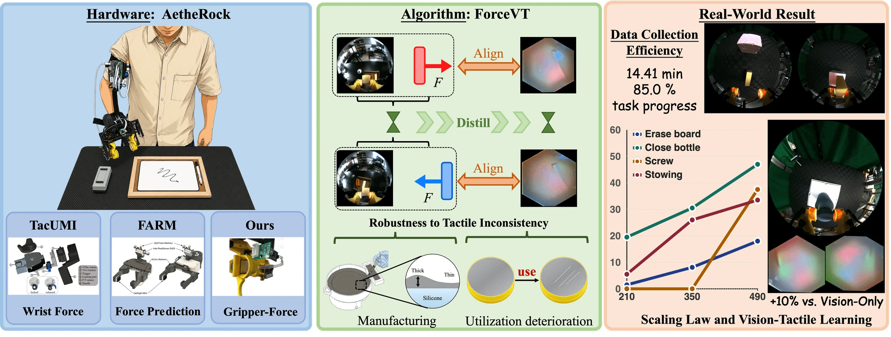
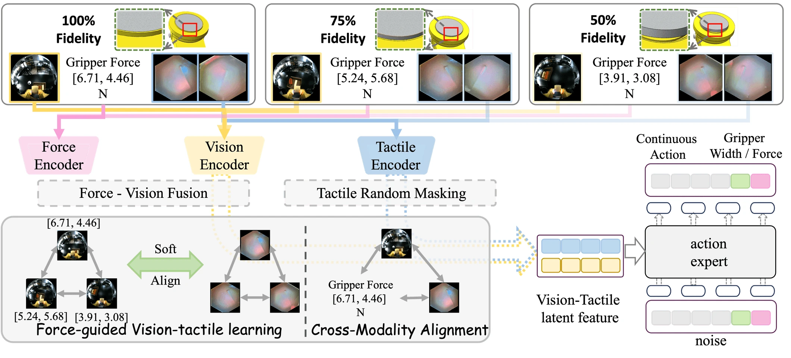

# AetheRock

**An Arm-Worn Robot Teaching System for Force-Guided Vision-Tactile Learning**

[Paper](https://arxiv.org/abs/2606.09777) · [Project page](https://lihongcs.github.io/aetherock/) · [Dataset](https://huggingface.co/datasets/lihong-cs/aetherock)



AetheRock records synchronized wrist vision, tactile observations, gripper force, and motion from human demonstrations. ForceVT uses vision and force during training to guide tactile representation learning across sensors with different tactile fidelities.

## Dataset

The [AetheRock dataset](https://huggingface.co/datasets/lihong-cs/aetherock) contains 3,760 demonstrations across 11 task archives. Browse [sampled frames](https://huggingface.co/datasets/lihong-cs/aetherock/viewer/frame_preview/preview) or follow the [data guide](data/README.md) to preview recordings, download individual tasks, and check the training data requirements.

## Collect demonstrations

The [HandCap guide](handcap/README.md) covers collector setup, device configuration, and optional HTC tracking. After configuring the sensors on the Linux collector, start a recording session from the repository root:

```bash
cd handcap
python handcap.py --cap_id 100001 --fps 20
```

Recordings are written to `handcap/data/handcap_100001/episode_*`. The [HandCap-to-LeRobot converter](handcap/Postprocess/_01_combine_and_transfer_data_into_lerobot_no_phone.py) combines raw HandCap recordings with tracker data.

## Train ForceVT



The [ForceVT training guide](openpi/TRAINING_README.md) describes the Linux/CUDA environment and task launchers for board erasing, screwdriving, bottle closing, and stowing. ForceVT post-trains a π₀.₅ policy using fused vision–force features to guide tactile learning and align representations across modalities. This repository is based on the June 2026 implementation. Its relational distillation loss uses KL divergence, and the launchers expose tactile masking as an option.

The launchers expect local LeRobot datasets grouped by tactile fidelity. The [data guide](data/README.md#prepare-data-for-forcevt) explains the format and labels required to use the Hugging Face archives for training.

Once the bottle-closing data is ready, run this from the repository root on a Linux machine with CUDA:

```bash
cd openpi
uv sync --no-dev
DATA_ROOT_BASE=/path/to/bottle-closing-data \
  uv run bash scripts/handcap_training/512_close_bottle/train_health_distill_tactile_wrist_force.sh
```

## Citation

```bibtex
@article{li2026aetherock,
  title   = {AetheRock: An Arm-Worn Robot Teaching System for Force-Guided Vision-Tactile Learning},
  author  = {Li, Hong and Xu, Yue and Tang, Yihan and Dong, Yankang and Liu, Chenyuan and Yu, Chenyang and Li, Xuyang and Huang, Siyuan and Shen, Yujun and Xue, Nan and Li, Yong-Lu},
  journal = {arXiv preprint arXiv:2606.09777},
  year    = {2026},
  doi     = {10.48550/arXiv.2606.09777}
}
```

## License

AetheRock's original code is available under the [Apache License, Version 2.0](LICENSE). See the [third-party notices](THIRD_PARTY_NOTICES.md) for the licenses and sources of bundled components.

See the [dataset guide](data/README.md) for data attribution.
