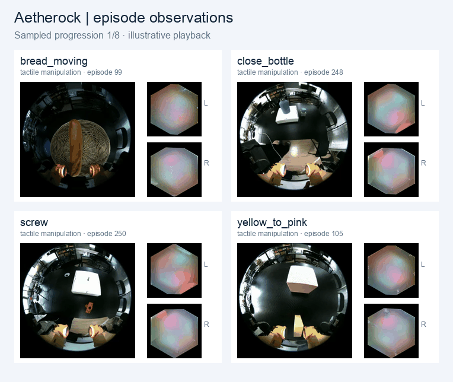

# AetheRock dataset

[Hugging Face dataset](https://huggingface.co/datasets/lihong-cs/aetherock) · [Frame preview](https://huggingface.co/datasets/lihong-cs/aetherock/viewer/frame_preview/preview) · [Episode index](https://huggingface.co/datasets/lihong-cs/aetherock/viewer/episode_index/episodes)

The dataset contains 3,760 demonstrations across 11 task archives (138.19 GB total). Each recording contains synchronized wrist RGB, two tactile image streams, gripper force, wrist pose, gripper values, and task instructions. The animation samples recorded episodes. The [dataset card](https://huggingface.co/datasets/lihong-cs/aetherock#original-archives) lists every archive.



## Download the original recordings

Accept the access conditions on the [dataset page](https://huggingface.co/datasets/lihong-cs/aetherock), then authenticate with the Hugging Face CLI. From the root of this repository, download a single task into `data/raw/`:

```bash
python -m pip install -U huggingface_hub
hf auth login
hf download lihong-cs/aetherock close_bottle/close_bottle.zarr.zip \
  --repo-type dataset --local-dir ./data/raw
```

The four ForceVT paper tasks correspond to these source archives:

| Task | Archive | Episodes |
| --- | --- | ---: |
| Erase board | `erase_board/erase_board.zarr.zip` | 498 |
| Screwdriving | `screw/screw.zarr.zip` | 501 |
| Close bottle | `close_bottle/close_bottle.zarr.zip` | 497 |
| Stowing | `stowing/stowing.zarr.zip` | 496 |

The repository on Hugging Face also contains a separate `eraseboard/eraseboard.zarr.zip` archive with 215 episodes. To download all 11 original archives, use:

```bash
hf download lihong-cs/aetherock --repo-type dataset \
  --include '*/*.zarr.zip' --local-dir ./data/raw
```

See the [dataset card's Zarr example](https://huggingface.co/datasets/lihong-cs/aetherock#read-an-original-zarr-archive) to read an archive without extracting it.

## Prepare data for ForceVT

The archives store demonstrations in Zarr v2. The [ForceVT launchers](../openpi/TRAINING_README.md) read LeRobot v3 datasets with one root per tactile fidelity. Each root must contain `data/`, `meta/`, and `videos/`. The four paper task launchers use the `health50`, `health75`, and `health100` groups.

The dataset card and episode index do not document an episode-to-fidelity mapping. Use verified fidelity labels when converting the archives to LeRobot. The HandCap converter in this repository reads raw collector and tracker files.

The dataset and preview above are credited to Li et al., [AetheRock](https://arxiv.org/abs/2606.09777), under [CC BY 4.0](https://creativecommons.org/licenses/by/4.0/). The preview samples original recordings and uses illustrative playback timing.
